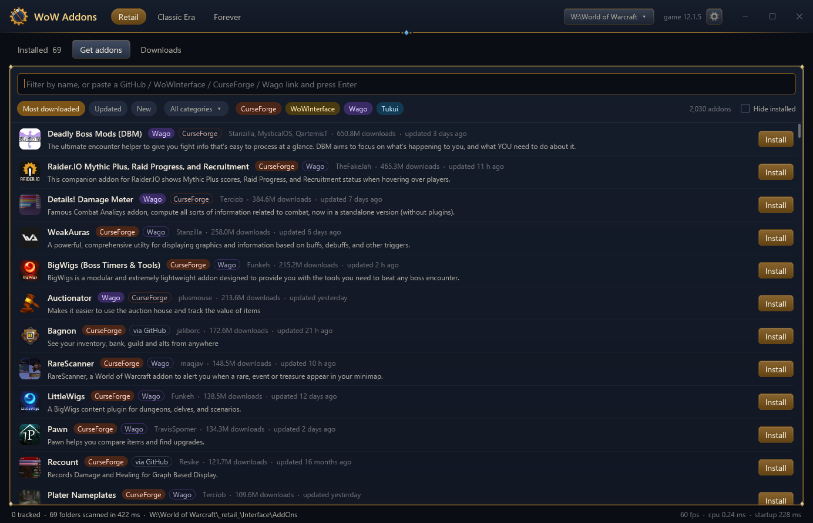
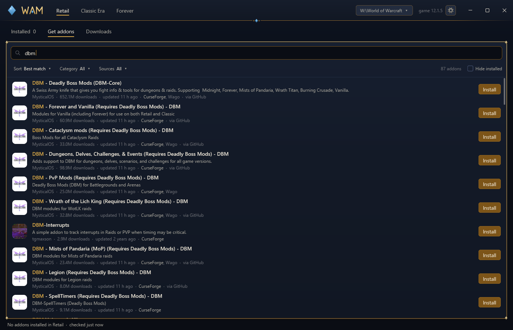
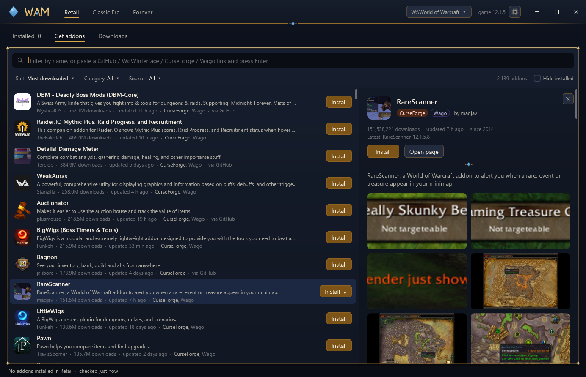
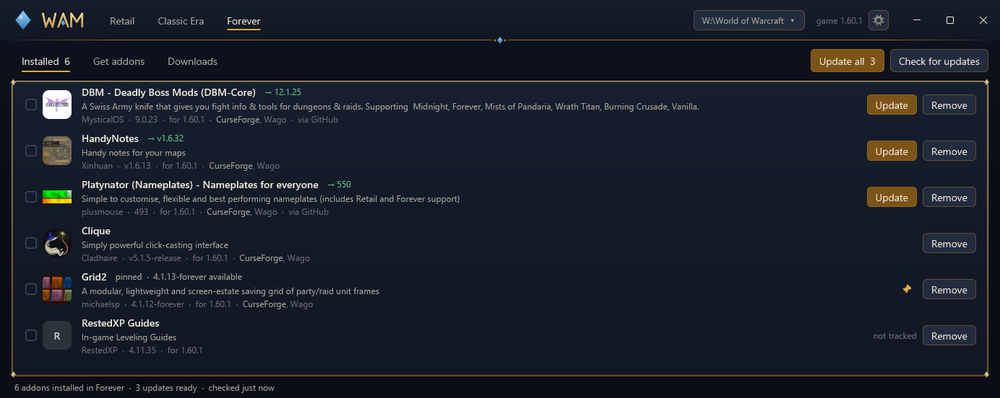
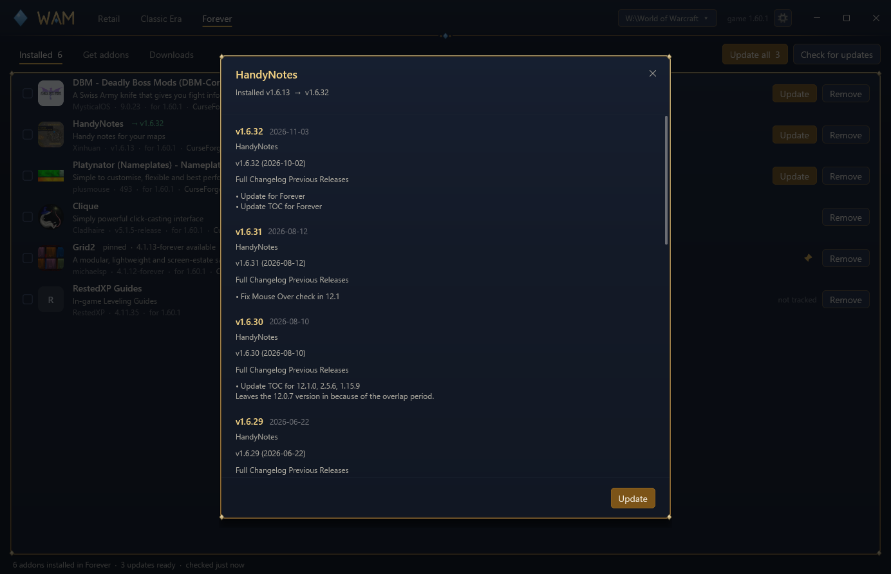
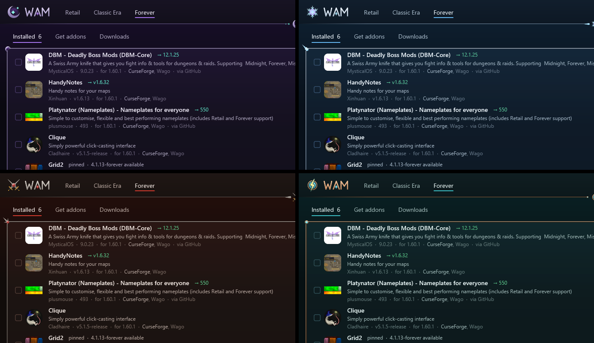

<p align="center">
  
</p>

<h1 align="center">wam — WoW Addon Manager</h1>

<p align="center">
  <b>Every addon source in one tiny, fast app. No installer, no ads, no tracking.</b><br>
  CurseForge · Wago · WoWInterface · GitHub · Tukui (ElvUI)
</p>

<p align="center">
  <a href="../../releases/latest"><b>⬇ Download the latest wam.exe</b></a>
  &nbsp;·&nbsp; Windows 10 / 11 &nbsp;·&nbsp; free and open source
</p>



## Why wam

- **⚡ Instant.** wam keeps a catalog of about 10,000 addons on your PC. Browsing, sorting, filtering
  and searching happen as you type, with no spinners and no page loads. It opens in a fraction of
  a second.
- **🪶 One small file.** `wam.exe` is under 1 MB. Nothing to install, nothing running in the
  background, no updater service, no overlay. Put it anywhere and run it; delete it and it's gone.
- **🌍 Every source, one list.** CurseForge, Wago, WoWInterface, GitHub and Tukui side by side. An
  addon published on several sites shows once, with every site it's on.
- **🛡 Careful with your setup.** Your addon settings are backed up before updates, a failed install
  rolls back, addons you edited yourself aren't overwritten, and removed addons go to the Recycle
  Bin.
- **🙅 No ads, no tracking.** wam has no account of its own, talks only to the addon sites and sends nothing about
  you anywhere. It's open source, so you can check.
- **🧭 Finds your game by itself.** Retail, Classic, Classic Era, Anniversary and the PTR and beta
  clients, on any drive, and every flavor of each install.

## Find anything in a keystroke

Start typing and the list filters itself. Fuzzy matching finds what you mean (`dbm` finds
*Deadly Boss Mods*) and highlights why each result matched. Sort by most downloaded, best match,
recently updated or new; filter by category (Unit Frames, Boss Encounters, Class › Mage, Professions
› Alchemy...) or by source. Addons without a version for your game are kept out of the way.



Paste a link from CurseForge, Wago, WoWInterface or GitHub and press Enter to install it straight
away. Dependencies an addon requires on CurseForge are installed along with it.

## See before you install

Select an addon to see its screenshots in a gallery (GIFs play; click one for full size), its description
and latest changelog the way the author formatted them,
download count and age, with links to its page, source code, issue tracker and where to support its author.



## Updates in one click

wam recognizes the addons you already have, including ones you installed by hand or with another
manager, and tells you which have updates. Click an update's new version to read what changed in
every release since yours before you install it. **Update all** takes care of them; addons you've
edited yourself are left alone unless you say otherwise, and addons you've **pinned** stay at their
version until you unpin them.





## Make it yours

Ten themes, each with its own colors, emblem and ornaments: from Tinker's gold and gems to Void,
Frostbound, Inferno, Fel, Bloodrage, Radiance, Wildgrowth and Stormcaller, or plain Slate. Pick one in
**Settings**.



## Built to be trusted with your UI

| | |
|---|---|
| **Settings backup** | Before updating, wam zips your `WTF` folder (where addons keep their settings), once a day, keeping the last 7. If the backup fails, nothing is updated. |
| **Safe installs** | New files are unpacked to the side first and moved in only when everything worked. Anything else rolls back, and a version that can't be put back is kept. |
| **Your edits stay** | If you changed an addon's files, it's marked *edited locally* and skipped by Update all. |
| **Undo-able removal** | Removed addons go to the Recycle Bin. wam offers to remove dependencies nothing else needs, and warns before you remove one something else still needs. |
| **Downloads you made yourself** | Archives you download (`.zip`, `.rar`, `.7z`) show up in wam as soon as they land, with the game version they're built for. Install them with one click, or drop one on the window. |
| **Respects authors** | When a CurseForge author allows downloads only from CurseForge's own site, wam uses the addon's GitHub releases if they're current, and otherwise opens that exact download page in a small visible window, never behind your back. |

## Small and fast, by design

wam is written in plain C with its own lightweight graphics: no web browser shipped inside it, no
framework to load.

| | |
|---|---|
| Download | one `.exe`, under 1 MB |
| Start-up | about 0.2 seconds |
| Catalog | ~10,000 addons, searched locally as you type |
| Installed list | 70 addons scanned in about 20 ms |
| Runs in the background | never |

## Get started

1. [Download `wam.exe`](../../releases/latest) and put it wherever you like.
2. Run it. wam finds your World of Warcraft install and lists your addons.
3. Open **Get addons**, pick something, press **Install**.

**Windows says "Windows protected your PC"?** New programs from small developers can get this
SmartScreen warning until enough people have run them. Click **More info**, then **Run anyway**.
To check that your copy is the one published here, compare its SHA-256 with the one in the release
notes:

```
certutil -hashfile wam.exe SHA256
```

### Requirements

- Windows 10 (version 1803 or later) or Windows 11, 64-bit.
- CurseForge: finding, installing and updating its addons needs an API key. wam has
  applied for access and doesn't include a key for now; if you already have one, you can add it in **Settings**.
- Wago: searching and installing from Wago needs your own Wago API key, which comes with a Wago
  subscription. Paste it in **Settings** (the cog at the top). The other sources work without an account.
- Addons whose authors allow downloads only from CurseForge's site open that page in a small window
  (Microsoft Edge WebView2, built into Windows 11 and current Windows 10), or in your browser.

## Your data

wam talks only to the addon sites (and the sites hosting their pictures) and to GitHub. It sends no
statistics and has no telemetry. What it keeps on your PC:

| Where | What |
|---|---|
| `%APPDATA%\wam` | settings (chosen WoW folder, theme, window layout), your own CurseForge and Wago keys, if you added them (encrypted for your Windows user), downloads already installed |
| `%LOCALAPPDATA%\wam` | caches: the addon catalog, pictures, your addons' fingerprints, the download window's browser profile; `tasks.log`, how long each install, update or removal took (for reporting a slow moment) |
| `<WoW>\<flavor>\Interface\wam.json` | which addons wam installed, and from where |
| `<WoW>\<flavor>\WTF-Backup` | the settings backups |

**Uninstalling**: delete `wam.exe` and the two `wam` folders above. Your addons stay installed.

## Problems and ideas

Please open an [issue](../../issues). Mention your Windows version, the WoW flavor, and the addon
involved. If something felt slow, `%LOCALAPPDATA%\wam\tasks.log` says how long each install,
update or removal waited and took.

## Building from source

wam is plain C with no dependencies beyond Windows: its own JSON parser, zip reader, Direct3D 11
renderer and UI. You need Visual Studio 2022 or its free
[Build Tools](https://visualstudio.microsoft.com/visual-cpp-build-tools/) with the C++ workload.

```
tools\vsenv.bat        sets up the compiler in this window (once per window)
build.bat release      builds build\wam.exe
build.bat test         builds and runs the unit tests
```

[CONTRIBUTING.md](CONTRIBUTING.md) explains how wam works, how the code is laid out, and how to
send changes. Security problems: see [SECURITY.md](SECURITY.md).

## License

wam is free software under the [GNU General Public License v3.0](LICENSE): you may use, study,
share and change it, and versions you distribute must stay under the same license, with their
source. wam.exe includes Microsoft's WebView2 loader, under its own license (see
[THIRD_PARTY_NOTICES.md](THIRD_PARTY_NOTICES.md)). It is not made by or affiliated with Blizzard Entertainment, CurseForge, Wago,
WoWInterface or Tukui. World of Warcraft is a trademark of Blizzard Entertainment, Inc.

## About

wam is made by davidsama. Designed, reviewed and tested by me, written with an AI coding assistant.
